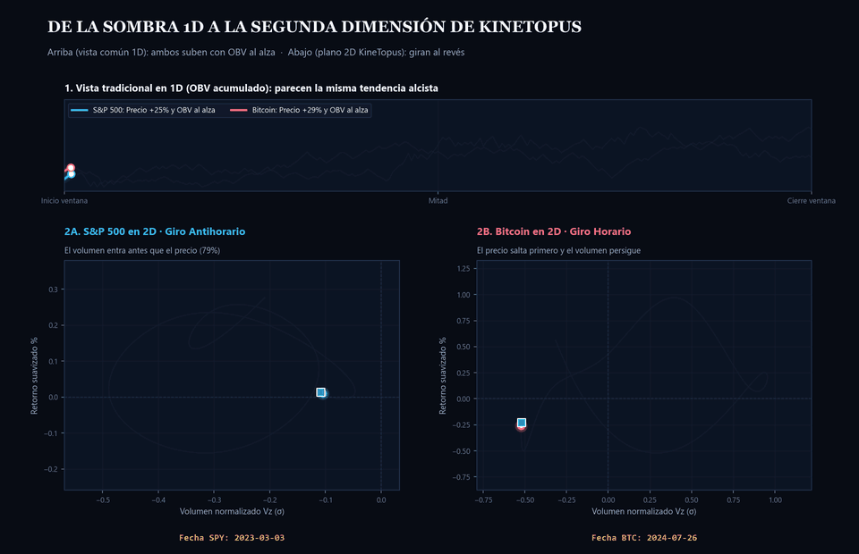
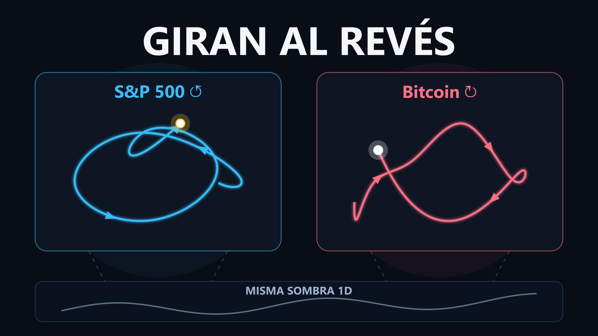
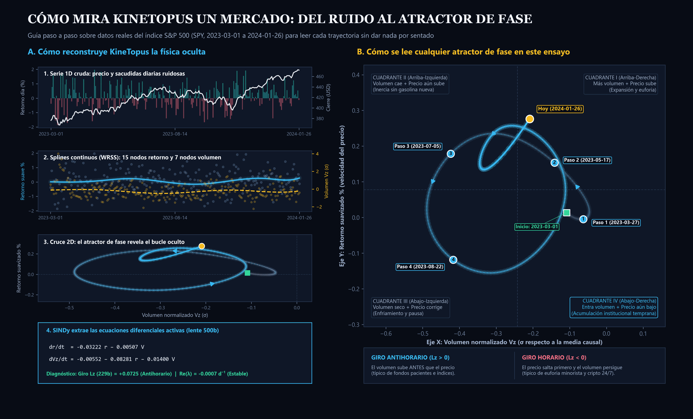
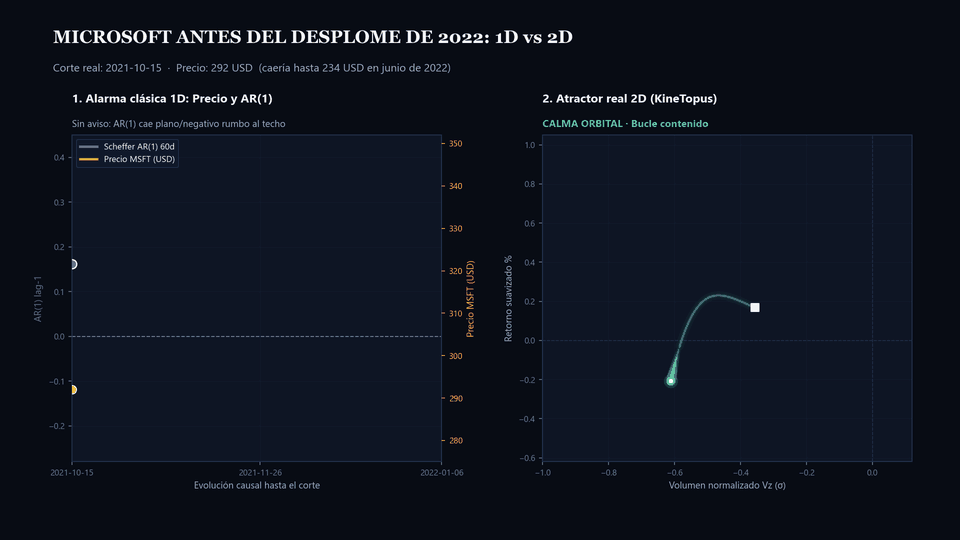
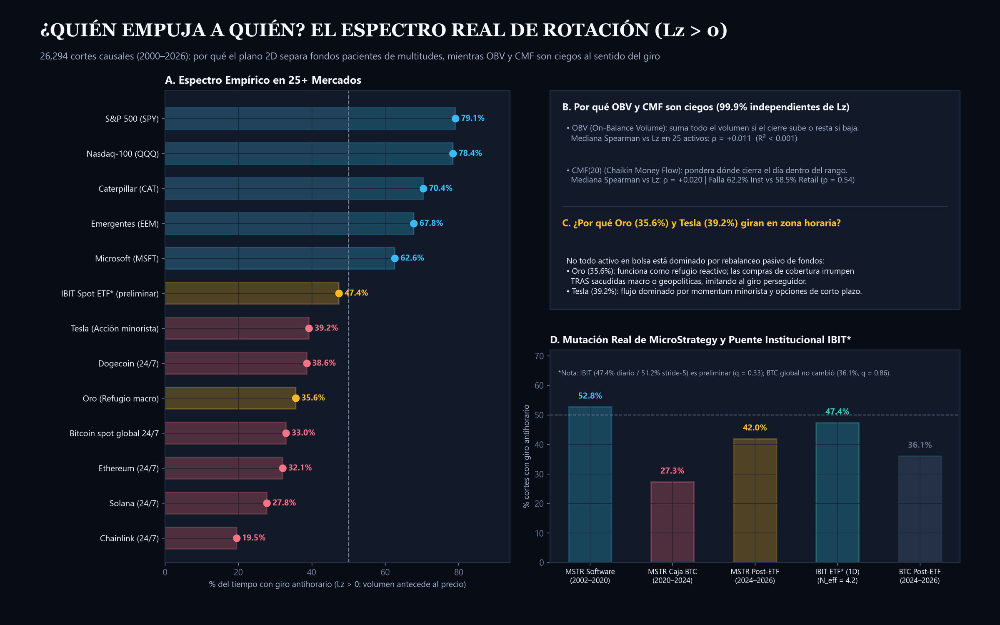
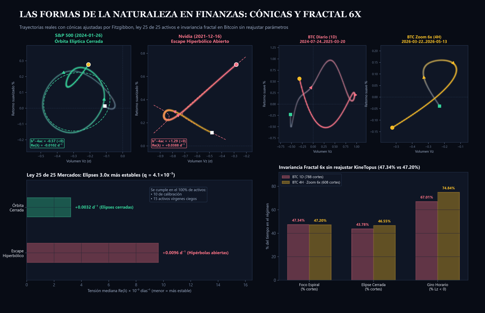
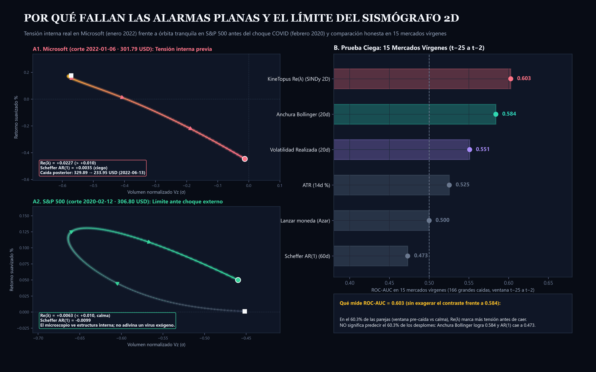
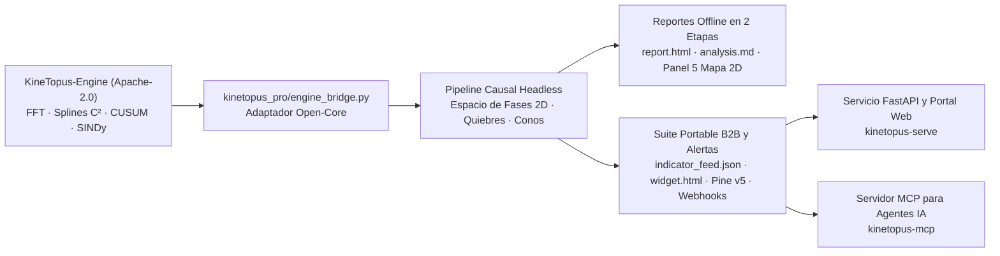
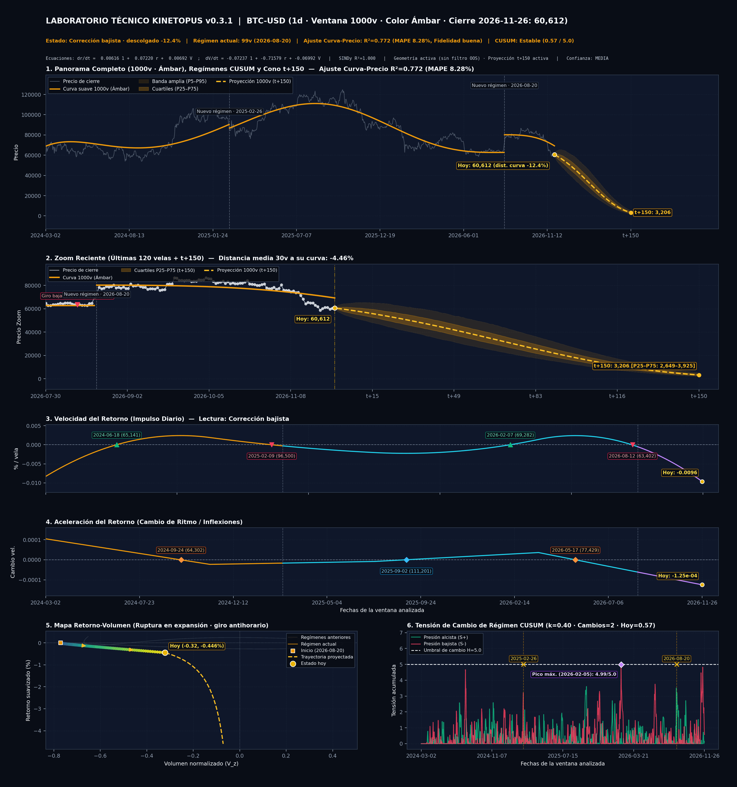

🌐 [English](README.md) | **Español**

<div align="center">

# 🔭 KineTopus-Analyst

**La Segunda Dimensión del Dinero: Un Microscopio Físico de Caja Blanca del Atractor de Fase 2D en los Mercados**

*Construido sobre [`KineTopus-Engine`](https://github.com/JuanDie778/KineTopus-Engine) (`Apache-2.0`) · Validado en `26,294` instantáneas causales reales (`2000–2026`)*

[](https://github.com/JuanDie778/KineTopus-Analyst/actions/workflows/ci.yml)
[](https://github.com/JuanDie778/KineTopus-Analyst/releases/tag/v0.4.0)
[](https://www.python.org/)
[](LICENSE)
[-22d3ee.svg)](https://github.com/JuanDie778/KineTopus-Engine)
<br>
[](https://papers.ssrn.com/sol3/papers.cfm?abstract_id=7431018)
[](https://doi.org/10.5281/zenodo.24166175)
[](https://orcid.org/0009-0008-9155-4653)
[](https://huggingface.co/spaces/Juan778/KineTopus_Engine)

🎬 **[Ver el Video de 5 Minutos en YouTube](https://youtu.be/2g9QCzV2B4E)** &nbsp;·&nbsp; 📝 **[Leer el Ensayo Completo en Substack](https://substack.com/@juandiegoua778/note/p-225414681)** &nbsp;·&nbsp; 📄 **[Leer el Paper en SSRN](https://papers.ssrn.com/sol3/papers.cfm?abstract_id=7431018)**

</div>

---

## 🌀 La Ilusión de la Sombra 1D

Mira dos subidas reales del mercado cara a cara: el **S&P 500** sube un `+25%`, **Bitcoin** sube un `+29%`, y abajo su volumen acumulado (`OBV`) parece casi idéntico. En cualquier pantalla de bolsa de los últimos sesenta años, contarían exactamente la misma historia.

**Pero si giramos la cámara hacia la segunda dimensión, aparece esto:**



**Están girando en sentidos opuestos.** Los indicadores clásicos en 1D aplastan dos fuerzas dinámicas en una sola línea — igual que dos trompos girando al revés cuyas sombras en la pared dibujan el mismo vaivén plano.

<div align="center">

[](https://youtu.be/2g9QCzV2B4E)

*👆 Haz clic en la miniatura para ver el recorrido completo en [YouTube](https://youtu.be/2g9QCzV2B4E), o profundiza en todas las notas metodológicas en el [Ensayo de Substack](https://substack.com/@juandiegoua778/note/p-225414681).*

</div>

---

## 🔬 De Galileo al Microscopio de Espacio de Fases 2D

Imagina grabar a pulso una piedra cayendo desde un balcón. Si restas un fotograma menos el anterior para medir la velocidad, el temblor de tu mano destruye la física en dientes de sierra. Pero si trazas primero una **curva continua sin mirar jamás el futuro**, emerge intacta una ley exacta: `9.8 m/s²`.

Así opera [**KineTopus-Engine**](https://github.com/JuanDie778/KineTopus-Engine) por dentro (`FFT` → `Splines C²` causales → quiebres `CUSUM` → EDOs dispersas con `SINDy`). Y al ejecutar el **Gran Estudio v3 (`26,294` instantáneas causales entre `2000 y 2026`, con parámetros congelados y cero fuga de futuro)** descubrimos su aplicación práctica más potente: **enfrentar el volumen normalizado (`Eje X = Vz`) contra el retorno suavizado (`Eje Y`) en un Atractor de Fase 2D**.

La línea plana se abre en una órbita viva con **cuatro estaciones claras**:
1. **Cuadrante IV (abajo a la derecha):** Entra volumen silencioso con el precio aún frío.
2. **Cuadrante I (arriba a la derecha):** El retorno acelera cuando el consenso acompaña.
3. **Cuadrante II (arriba a la izquierda):** El volumen se retira mientras el precio sigue por inercia.
4. **Cuadrante III (abajo a la izquierda):** El mercado descansa y enfría excesos.

- **Sentido antihorario (`Lz > 0`, `IV → I → II → III`):** El capital paciente compra *antes* del titular.
- **Sentido horario (`Lz < 0`):** Primero salta el precio, y la multitud corre detrás.

<details>
<summary>🗺️ <strong>Guía Visual: Cómo Leer un Atractor de Fase 2D Vivo (Caso Real S&P 500)</strong> — Clic para desplegar</summary>



</details>

---

## 📊 Qué Revelaron 26,294 Instantáneas Reales (`2000–2026`, `15` Mercados Vírgenes)

Lejos de jugar a adivinar titulares, el microscopio 2D reveló cuatro huellas empíricas reproducibles sobre **27 series** (incluidos **15 mercados vírgenes** jamás tocados al calibrar):

| Descubrimiento | Evidencia Empírica (`26,294` Cortes Causales) | Utilidad Práctica Directa |
| :--- | :--- | :--- |
| **1. Giro Oculto (`Lz`)**<br>*99.9% independiente de `OBV` y `CMF(20)`* | **Bloque institucional (`>55%`):** `S&P 500 (79%)`, `Nasdaq-100 (78%)`, `CAT (70%)`, `Emergentes (68%)`, `MSFT (63%)`<br>**Bloque reactivo/cripto (`<40%`):** `BTC (33%)`, `ETH (32%)`, `SOL (28%)`, además de `Oro (36%)` y `Tesla (39%)` | Demuestra que el giro capta **psicología colectiva, no horarios de bolsa**: ahorro paciente frente a persecución del movimiento — invisible para `OBV` (`ρ = +0.011`) y `CMF` (`ρ = +0.020`). |
| **2. Mutación en Vivo**<br>*MicroStrategy (`2018–2026`)* | **`53%`** (18 años como firma tranquila de software) → **`27%`** (al convertir su tesorería en Bitcoin en ago 2020) → **`42%`** (tras los ETFs spot de 2024; `IBIT` marca `47%` diario / `51%` semanal) | Sin cambiar de nombre en bolsa, mutó de especie financiera en el espacio de fases mientras `CMF` seguía ciego cerca del `50%`. |
| **3. Elipses vs. Hipérbolas (`Fitzgibbon`) y Fractal `6x`** | Las elipses cerradas son **`3` veces más estables** (`Re(λ)` mediana `+0.0032` vs `+0.0096 d⁻¹`) en el **`100%` (`25/25`)** de los mercados diarios. Bajando el zoom `6x` a **`BTC 4H`** (`3,543` barras, cero reajustes), el foco espiral queda clavado en **`47%` vs. `47%`**. | Distingue órbitas contenidas que regresan al centro (`S&P 500`) de escapes abiertos (`Nvidia` fines de 2021): geometría real del mercado, no artefacto del reloj diario. |
| **4. Sismógrafo 2D (`Re(λ)`) vs. `Scheffer AR(1)`** | Ante **`166` desplomes severos** en `15` mercados vírgenes: **`ROC-AUC = 0.603`** (`Re(λ)`) frente a `0.584` (`Anchura Bollinger`) y **`0.473` (`Scheffer AR(1)`)** (peor que lanzar una moneda). | Detecta fragilidad interna antes del giro — como en **Microsoft ene 2022 (`330 → 234 USD`)**, donde `AR(1)` dormía plano mientras la órbita 2D se abría en rojo. |

### El Sismógrafo 2D en Vivo (`Microsoft`, Oct 2021 – Ene 2022)



<details>
<summary>🖼️ <strong>Gráficas de Respaldo: Mapa de Giros, Fractal 6x Fitzgibbon y Ranking Ciego ROC-AUC</strong> — Clic para desplegar</summary>

1. **Quién Empuja a Quién (`26,294` cortes, ceguera `OBV`/`CMF` y caso `Oro`/`Tesla`):**
   
2. **Elipses Cerradas vs. Hipérbolas e Invariancia Fractal `6x` (`BTC 1D` vs `4H`):**
   
3. **Ranking Ciego `ROC-AUC` y Límite Honesto (`S&P 500` el 12 de feb de 2020 Pre-COVID):**
   

</details>

### ⚖️ Un Instrumento de Navegación — Con Límites Honestos Explícitos
Un instrumento serio demuestra su rigor enseñando también **lo que no puede ver**:
- **Los choques exógenos siguen siendo exógenos:** El `12 de febrero de 2020`, días antes del desplome por COVID, el `S&P 500` dibujaba una elipse tranquila porque dentro del libro de órdenes aún no había fractura interna. **Un microscopio mide fragilidad interna del capital; jamás adivina un virus.**
- **Crisis largas (`2008`):** Filtros lentos (`SMA-200`, `VolTarget`) siguen protegiendo mejor como regla total en mercados bajistas prolongados; la tensión 2D brilla como **sismógrafo local y modulador de riesgo**.
- **Horizontes cortos en splines:** Los bordes `not-a-knot` de un spline cúbico solo sostienen curvatura unos pocos días libres, nunca a meses vista.
- **Payoff práctico real:** Te da serenidad para sostener posiciones cuando la elipse gira antihoraria en manos pacientes; y **disciplina para reducir exposición o apalancamiento a la mitad** cuando el giro vira a horario y `Re(λ)` se abre en rojo (reduciendo el drawdown máximo en `8/8` criptoactivos netos de comisiones).

---

## 🛠️ Del Descubrimiento al Software: Qué Corre Hoy (`v0.4.0`) y Qué Sigue (`v0.5.0`)

**KineTopus-Analyst (`kinetopus_pro`)** es la capa de producto *Local-First* Open-Core construida sobre [`KineTopus-Engine`](https://github.com/JuanDie778/KineTopus-Engine):

- **Disponible hoy en [`v0.4.0`](https://github.com/JuanDie778/KineTopus-Analyst/releases/tag/v0.4.0):** CLI reproducible (`kinetopus-analyze`), `report.html` interactivo offline en 2 etapas (que incluye el **Mapa 2D Retorno-Volumen y sentido de giro orbital en el Panel 5** junto con curvas multi-escala y forense CUSUM), contrato JSON compacto (`indicator_feed.json`), widget SVG `< 35 KB` embebible (`widget.html`), TradingView Pine Script v5 (`indicator.pine`), 6 alertas deduplicadas por SHA-256 con webhook, Portal Web FastAPI (`kinetopus-serve`) y servidor MCP (`kinetopus-mcp`) optimizado para `≤ 16 GB` RAM (`np.float64` `C_CONTIGUOUS`).
- **Próximo Hito (`v0.5.0`, [Roadmap](docs/ROADMAP_PRO.md)):** Promover el **Microscopio 2D del Gran Estudio v3** (`Lz` % antihorario, cónicas `Fitzgibbon`, sismógrafo `Re(λ)` y modulador de riesgo al `50%`) + **Escáner Multi-Activo** al centro del CLI, widget y API.



<details>
<summary>⚙️ <strong>Vista Técnica de los Artefactos Actuales `v0.4.0` (Dashboard de 6 Paneles y Widget SVG &lt; 35 KB)</strong> — Clic para desplegar</summary>

El **Panel 5 (`Mapa Retorno-Volumen`)** del laboratorio de 6 paneles ya renderiza el atractor 2D y su giro junto con la tensión CUSUM (`Panel 6`) y el widget SVG embebible:




</details>

---

## ⚡ Inicio Rápido (100% Reproducible, Local-First)

**Requisitos:** Python `3.10+` y hasta `16 GB` de RAM.

```bash
# 1. Instalar el núcleo científico open-source desde GitHub
pip install "git+https://github.com/JuanDie778/KineTopus-Engine.git"

# 2. Clonar e instalar KineTopus-Analyst (CLI, Portal FastAPI, Servidor MCP y pytest)
git clone https://github.com/JuanDie778/KineTopus-Analyst.git
cd KineTopus-Analyst
pip install -e ".[service,dev]"
```

```bash
# Ejecutar análisis completo offline (genera report.html, Panel 5 Espacio de Fases 2D, widget.html, Pine v5 y alertas)
kinetopus-analyze --ticker "SPY" --interval 1d

# Opcional: incluir auditoría causal Walk-Forward OOS
kinetopus-analyze --ticker "BTC-USD" --interval 1d --audit-oos

# Levantar Portal Web + API REST B2B (http://127.0.0.1:8000) o Servidor MCP stdio
kinetopus-serve --host 127.0.0.1 --port 8000
kinetopus-mcp

# Ejecutar los 22 tests de auditoría automatizados
pytest tests/ -v -W ignore::UserWarning
```

---

## 📚 Documentación Bilingüe

| Documento | Español | English |
| :--- | :--- | :--- |
| **Manifiesto de Producto (Norte: Atractor 2D)** | [docs/MANIFIESTO.md](docs/MANIFIESTO.md) | [docs/en/MANIFESTO.md](docs/en/MANIFESTO.md) |
| **Arquitectura Open-Core (`v0.4.0`)** | [docs/ARCHITECTURE_PRO.md](docs/ARCHITECTURE_PRO.md) | [docs/en/ARCHITECTURE.md](docs/en/ARCHITECTURE.md) |
| **Roadmap (`v0.5.0` Microscopio 2D + Escáner)** | [docs/ROADMAP_PRO.md](docs/ROADMAP_PRO.md) | [docs/en/ROADMAP.md](docs/en/ROADMAP.md) |
| **Historial de Cambios y Seguridad** | [CHANGELOG.md](CHANGELOG.md) | [SECURITY.md](SECURITY.md) |

---

## ⚖️ Licencia, Uso Comercial y Citación

**KineTopus-Analyst** se publica bajo la [**Licencia Source-Available de Evaluación No Comercial**](LICENSE):
- ✅ **Permitido:** Ver, clonar, estudiar y ejecutar localmente para **uso personal, educativo, evaluación técnica o investigación académica no comercial**.
- ❌ **Restringido sin Licencia Comercial:** Productos comerciales de trading/asesoría, alojamiento SaaS/API para terceros, feeds de señales pagos o redistribución comercial.
- 🔓 **Núcleo Upstream Abierto:** Construido sobre [`KineTopus-Engine`](https://github.com/JuanDie778/KineTopus-Engine), que sigue siendo **100% Apache-2.0** (ver [NOTICE](NOTICE)).

**Consultas de Licenciamiento Comercial / B2B:** Contacta con **Juan Diego Ussa Aponte** en [ussaapontejuandiego@gmail.com](mailto:ussaapontejuandiego@gmail.com) o [@JuanDie778](https://github.com/JuanDie778).

<details>
<summary>🎓 <strong>Citar la Investigación Científica Base (BibTeX)</strong></summary>

```bibtex
@misc{ussa2026kinetopus,
  author       = {Ussa Aponte, Juan Diego},
  title        = {Kinetopus Engine: A Parsimonious Physical-Mathematical Pipeline for Local-First Financial Time Series Forecasting using Sparse Identification of Dynamical Systems (SINDy)},
  year         = {2026},
  doi          = {10.5281/zenodo.24166175},
  url          = {https://papers.ssrn.com/sol3/papers.cfm?abstract_id=7431018}
}
```

</details>

> ⚠️ **Aviso Legal:** *Software de investigación cuantitativa y física computacional basado en datos históricos reales (`2000–2026`). Nada en este repositorio constituye asesoría financiera ni recomendación de inversión.*
