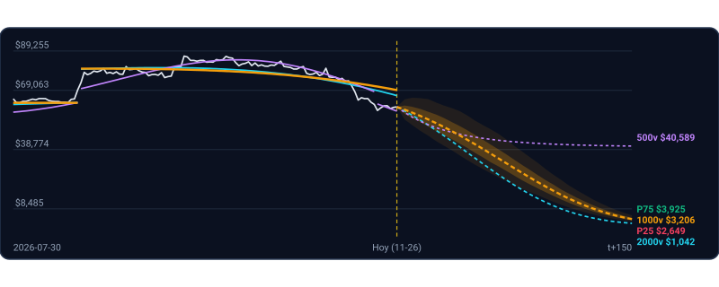
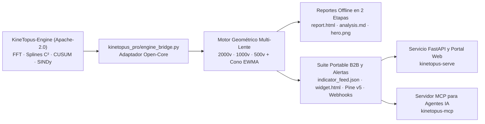

🌐 [English](README.md) | **Español**

<div align="center">

# 🔭 KineTopus-Analyst (`v0.4.0`)

**Geometría de Mercado Multi-Lente de Caja Blanca, Suite Portable B2B (Widget SVG `< 35 KB`, TradingView Pine Script v5, Alertas Activas) y Micro-Servicio FastAPI / MCP**

*Convirtiendo las ecuaciones diferenciales de Física Computacional Financiera en un radar cuantitativo intuitivo, reproducible y Local-First.*

[](https://github.com/JuanDie778/KineTopus-Analyst/actions/workflows/ci.yml)
[](https://github.com/JuanDie778/KineTopus-Analyst/releases/tag/v0.4.0)
[](https://www.python.org/)
[](LICENSE)
[-22d3ee.svg)](https://github.com/JuanDie778/KineTopus-Engine)
<br>
[](https://papers.ssrn.com/sol3/papers.cfm?abstract_id=7431018)
[](https://doi.org/10.5281/zenodo.24166175)
[](https://orcid.org/0009-0008-9155-4653)
[](https://huggingface.co/spaces/Juan778/KineTopus_Engine)

🎬 **[Ver el Video en YouTube](https://youtu.be/2g9QCzV2B4E)** &nbsp;·&nbsp; 📝 **[Leer el Post en Substack](https://substack.com/@juandiegoua778/note/p-225414681)** &nbsp;·&nbsp; 📄 **[Leer el Paper en SSRN](https://papers.ssrn.com/sol3/papers.cfm?abstract_id=7431018)**

</div>

---

## 🧭 Por qué creé KineTopus-Analyst (Del Paper Científico al Radar Diario)

Empecé [**KineTopus-Engine**](https://github.com/JuanDie778/KineTopus-Engine) con una duda que no me dejaba en paz mirando gráficos financieros: cuando observas una serie de precios en la escala correcta, muchos tramos dibujan parábolas, decaimientos exponenciales u oscilaciones amortiguadas casi de libro — *¿y si no fuera una ilusión óptica del ojo humano, sino ecuaciones diferenciales locales ocultas temporalmente bajo el ruido?*

Construir el motor científico demostró la tesis matemática (`FFT`, `Splines C²`, `CUSUM`, `SINDy`, `Euler-Maruyama`), pero enseguida dejó ver el siguiente reto igual de importante: **una ecuación encerrada en un script de investigación no le sirve a un analista, inversor o plataforma fintech que necesita diagnosticar un activo en 10 segundos.**

**KineTopus-Analyst** (`kinetopus_pro`) es la capa de producto y servicio construida en arquitectura Open-Core sobre ese motor público (`Apache-2.0`). En lugar de obligarte a descifrar ecuaciones diferenciales crudas o pelear con cajas negras opacas, evalúa **tres lentes geométricas simultáneas** (`2000`, `1000` y `500` velas) en tu propio equipo, mide con transparencia qué tan bien sigue el precio a su curva, detecta quiebres estructurales CUSUM y entrega el diagnóstico listo para consumir donde tú trabajes: reporte HTML interactivo offline, widget SVG embebible `< 35 KB`, indicador Pine Script v5 en TradingView, alertas activas, API FastAPI o servidor MCP para agentes de IA.

> *La misma física computacional de caja blanca por dentro. Lectura humana directa por fuera.*

---

## 📊 Vitrina Visual Real — Salida en Vivo (`BTC-USD`, Diario)

Esta es una captura real, sin edición manual, generada al ejecutar `kinetopus-analyze --ticker "BTC-USD" --interval 1d` (cierre `60,612 USD` el `2026-11-26`):


### Cómo leer este gráfico en 15 segundos
1. **Tres Escalas Simultáneas (`2000v` · `1000v` · `500v`):**
   - **Cian (`2000v`):** La marea estructural de largo plazo.
   - **Ámbar (`1000v`):** El eje principal que alimenta los rangos ejecutivos (`1s`, `1m`, `3m`, `t+150`) y el cono probabilístico.
   - **Violeta (`500v`):** El pulso táctico de corto plazo que emite pines de quiebre CUSUM recientes y giros de velocidad.
   - *Las tres lentes proyectan siempre `t+150` de forma simultánea, sin bloqueos predictivos arbitrarios.*
2. **Ajuste Curva-Precio y Estiramiento:** Cuando las velas cotizan muy por encima o por debajo de su curva suave (por ejemplo, `-12.4%` descolgado bajo la lente `1000v`), ves al instante si el precio está sobreextendido o regresando hacia su variedad, acompañado siempre por sus métricas explícitas `R²` y `MAPE`.
3. **Cono EWMA Calibrado (`P25–P75` y `P5–P95`):** En lugar de inflar el ruido por doble integración, `2,000` trayectorias de integración simple en log-precio escaladas por volatilidad EWMA RiskMetrics (`span=30`, winsorizada por MAD) dibujan objetivos realistas de primer toque en la regla derecha libre de solapes.

<details>
<summary>🔬 <strong>Explorar el Laboratorio Técnico de 6 Paneles (Dashboard `1000v`)</strong> — Clic para desplegar</summary>

Cada escala exporta además un dashboard técnico de 6 paneles (y 18 paneles individuales en PNG) con:
1. Panorama completo de la ventana + cono calibrado (`R² = 0.772`, `MAPE = 8.28%`).
2. Zoom táctico reciente (`120` últimas velas + `t+150`).
3. Velocidad del retorno (`dr/dt`) y cruces por cero.
4. Aceleración del retorno (`d²r/dt²`) e inflexiones.
5. Mapa de espacio de fases 2D Retorno-Volumen (`V_z` vs. retorno suavizado) y sentido de giro orbital.
6. Auditoría histórica completa de **tensión CUSUM** (`S+ / S-` frente al umbral `H = 5.0`), preservada con rigor fuera de la vista ejecutiva limpia.


</details>

<details>
<summary>🧩 <strong>Explorar el Widget Vectorial Embebible (&lt; 35 KB SVG Puro)</strong> — Clic para desplegar</summary>

Pensado para portales fintech, newsletters y terminales propios (listo para `<iframe>` en `< 35 KB`, cero dependencia de `plotly.min.js`, modo Oscuro/Claro, acompañado por `indicator_feed.json`, TradingView `indicator.pine` y `alerts.json`):



</details>

---

## ✨ Qué Incluye (`v0.4.0`)

| Capa | Qué Entrega | Artefactos / Comandos Clave |
| :--- | :--- | :--- |
| **1. Motor Geométrico Multi-Lente** | Análisis paralelo `2000v / 1000v / 500v` sobre descarga única inteligente (`10y` con respaldo automático a `max`), rescate *Autopilot 2D*, guardarraíl anti-explosión exponencial en EDOs, test residual `Ljung-Box` y auditoría Walk-Forward OOS opcional (`--audit-oos`). | `kinetopus-analyze --ticker "BTC-USD"` |
| **2. Reportes Offline en Dos Etapas** | Historial completo al 100% persistido en `report_bundle.npz`; `report.html` autocontenido (`plotly.min.js`, selectores `[120v \| 500v \| 1000v \| 2000v \| Todo]`, cono, 3 dashboards, Oscuro/Claro) + fusión determinista `--render-report` con `narrative.json`. | `report.html`, `analysis.md`, `confluence.json` |
| **3. Suite Portable B2B y Alertas Activas** | Contrato JSON ligero (`kinetopus.indicator.v1`, `~5–12 KB`), `widget.html` SVG puro `< 35 KB`, overlay **TradingView Pine Script v5** (`indicator.pine`) y 6 reglas deterministas de alertas con deduplicación SHA-256 y despacho webhook. | `indicator_feed.json`, `widget.html`, `indicator.pine`, `alerts.json` |
| **4. Micro-Servicio FastAPI y Servidor MCP** | Portal Web ligero + API REST (`kinetopus-serve`) protegida bajo `threading.Lock` para equipos de `≤ 16 GB` RAM, más servidor MCP `stdio` (`kinetopus-mcp`) para agentes de IA. | `kinetopus-serve`, `kinetopus-mcp` |

---

## 🏗️ Arquitectura Open-Core

**KineTopus-Analyst** mantiene una frontera limpia de desacoplamiento: `kinetopus_pro/engine_bridge.py` es el **único** módulo que importa `kinetopus-engine` (`Apache-2.0`), dejando el núcleo científico original 100% intacto.



---

## ⚡ Inicio Rápido (100% Reproducible)

**Requisitos:** Python `3.10+` y hasta `16 GB` de RAM (diseño *Local-First* vectorizado en `np.float64` `C_CONTIGUOUS`).

### 1. Instalación
```bash
# Instalar el núcleo científico open-source desde GitHub
pip install "git+https://github.com/JuanDie778/KineTopus-Engine.git"

# Clonar e instalar KineTopus-Analyst (con extras de servicio FastAPI/MCP y pytest)
git clone https://github.com/JuanDie778/KineTopus-Analyst.git
cd KineTopus-Analyst
pip install -e ".[service,dev]"
```

<details>
<summary>💡 <strong>¿Trabajas con un clon hermano local de KineTopus-Engine?</strong></summary>

`engine_bridge.py` detecta automáticamente una carpeta hermana `../KineTopus-Engine` o la variable de entorno `KINETOPUS_ENGINE_DIR` si el núcleo científico no está instalado de forma global vía `pip`.

</details>

### 2. Ejecutar tu Primer Análisis Multi-Lente
```bash
# Corrida estándar Geométrica Pura (genera report.html, hero.png, widget.html, Pine v5 y alertas)
kinetopus-analyze --ticker "BTC-USD" --interval 1d

# Opcional: activar auditoría retrospectiva Walk-Forward OOS junto a la geometría viva
kinetopus-analyze --ticker "SPY" --interval 1d --audit-oos

# Actualizar artefactos portables B2B y despachar alertas nuevas vía webhook (< 0.2 s)
kinetopus-analyze --export-portable "reports/BTC-USD/<TIMESTAMP>" --webhook-url "https://hooks.example.com/..."
```

### 3. Levantar Portal HTTP / API o Servidor MCP
```bash
# Portal Web Ligero + API REST B2B en http://127.0.0.1:8000
kinetopus-serve --host 127.0.0.1 --port 8000

# Servidor MCP stdio para asistentes IA (list_analyzed_assets, get_asset_indicator, get_asset_alerts, get_tradingview_pine)
kinetopus-mcp
```

### 4. Ejecutar la Suite de Tests Offline
```bash
pytest tests/ -v -W ignore::UserWarning
```

---

## 📚 Documentación y Hoja de Ruta (`v0.5.0` Siguiente Frente)

| Tema | Español | English |
| :--- | :--- | :--- |
| **Manifiesto y Norte de Producto** | [docs/MANIFIESTO.md](docs/MANIFIESTO.md) | [docs/en/MANIFESTO.md](docs/en/MANIFESTO.md) |
| **Arquitectura Open-Core (`v0.4.0`)** | [docs/ARCHITECTURE_PRO.md](docs/ARCHITECTURE_PRO.md) | [docs/en/ARCHITECTURE.md](docs/en/ARCHITECTURE.md) |
| **Roadmap (`v0.5.0` Escáner Multi-Activo)** | [docs/ROADMAP_PRO.md](docs/ROADMAP_PRO.md) | [docs/en/ROADMAP.md](docs/en/ROADMAP.md) |
| **Historial de Cambios y Seguridad** | [CHANGELOG.md](CHANGELOG.md) | [SECURITY.md](SECURITY.md) |

**Próximo Frente — Hito 3 (`v0.5.0` Escáner Multi-Activo y Multi-Serie):** Barrido transversal sobre lotes mixtos de tickers de Yahoo Finance y CSVs locales (incluidos pares dinámicos acoplados `(X, Y)` no financieros con ceros o negativos bajo `--classic-price`), exportando tablas maestras deterministas `JSON/CSV` conectadas al servicio HTTP.

---

## ⚖️ Licencia, Uso Comercial y Citación

**KineTopus-Analyst** se publica bajo la [**Licencia Source-Available de Evaluación No Comercial**](LICENSE):
- ✅ **Permitido:** Ver, clonar, estudiar y ejecutar localmente para **uso personal, educativo, evaluación técnica o investigación académica no comercial**.
- ❌ **Restringido sin Licencia Comercial:** Productos comerciales de trading/asesoría, alojamiento SaaS/API para terceros, feeds de señales pagos o redistribución comercial.
- 🔓 **Núcleo Upstream Abierto:** Construido sobre [`KineTopus-Engine`](https://github.com/JuanDie778/KineTopus-Engine), que sigue siendo **100% Apache-2.0** (ver [NOTICE](NOTICE)).

**Consultas de Licenciamiento Comercial / B2B:** Contacta con **Juan Diego Ussa Aponte** en [ussaapontejuandiego@gmail.com](mailto:ussaapontejuandiego@gmail.com) o [@JuanDie778](https://github.com/JuanDie778).

<details>
<summary>🎓 <strong>Citar la Investigación Científica Base (BibTeX)</strong></summary>

```bibtex
@misc{ussa2026kinetopus,
  author       = {Ussa Aponte, Juan Diego},
  title        = {Kinetopus Engine: A Parsimonious Physical-Mathematical Pipeline for Local-First Financial Time Series Forecasting using Sparse Identification of Dynamical Systems (SINDy)},
  year         = {2026},
  doi          = {10.5281/zenodo.24166175},
  url          = {https://papers.ssrn.com/sol3/papers.cfm?abstract_id=7431018}
}
```

</details>

> ⚠️ **Aviso Legal:** *KineTopus-Analyst es una herramienta de física computacional e investigación cuantitativa. Ninguno de sus resultados, gráficos, indicadores, alertas o proyecciones constituye asesoría financiera ni recomendación de inversión.*
