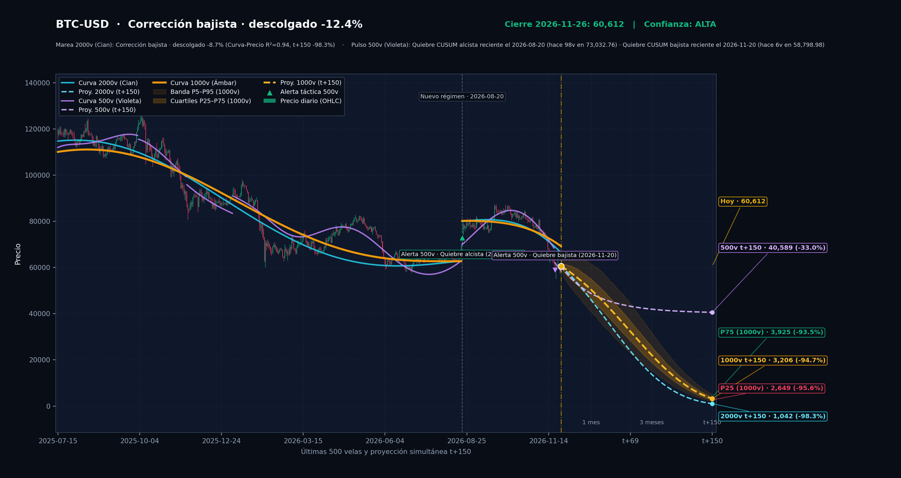
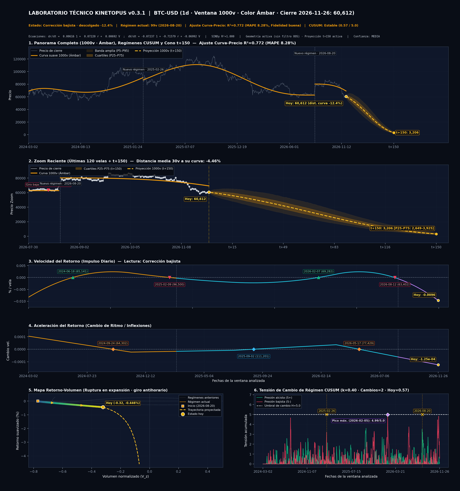

🌐 **English** | [Español](README.es.md)

<div align="center">

# 🔭 KineTopus-Analyst (`v0.4.0`)

**White-Box Multi-Lens Market Geometry, Portable B2B Indicator Suite (`< 35 KB` SVG Widget, TradingView Pine Script v5, Active Alerts) & FastAPI / MCP Service**

*Turning Computational Financial Physics differential equations into an intuitive, reproducible, local-first radar.*

[](https://github.com/JuanDie778/KineTopus-Analyst/actions/workflows/ci.yml)
[](https://github.com/JuanDie778/KineTopus-Analyst/releases/tag/v0.4.0)
[](https://www.python.org/)
[](LICENSE)
[-22d3ee.svg)](https://github.com/JuanDie778/KineTopus-Engine)
<br>
[](https://papers.ssrn.com/sol3/papers.cfm?abstract_id=7431018)
[](https://doi.org/10.5281/zenodo.24166175)
[](https://orcid.org/0009-0008-9155-4653)
[](https://huggingface.co/spaces/Juan778/KineTopus_Engine)

🎬 **[Watch the YouTube Deep Dive](https://youtu.be/2g9QCzV2B4E)** &nbsp;·&nbsp; 📝 **[Read the Substack Post](https://substack.com/@juandiegoua778/note/p-225414681)** &nbsp;·&nbsp; 📄 **[Read the SSRN Paper](https://papers.ssrn.com/sol3/papers.cfm?abstract_id=7431018)**

</div>

---

## 🧭 Why I Built KineTopus-Analyst (From Research Paper to Daily Radar)

I started [**KineTopus-Engine**](https://github.com/JuanDie778/KineTopus-Engine) with a question I couldn't shake while staring at market charts: when you zoom to the right scale, price paths often trace clean parabolas, exponential decays, and damped oscillations — *what if that wasn't pareidolia, but local differential equations temporarily masked by market noise?*

Building the scientific engine proved the mathematical thesis (`FFT`, `C² Splines`, `CUSUM`, `SINDy`, `Euler-Maruyama`), yet it immediately revealed a second, equally important gap: **an equation sitting inside a research script doesn't help a trader, risk analyst, or fintech team make sense of a chart in 10 seconds.**

**KineTopus-Analyst** (`kinetopus_pro`) is the product and service layer built on top of that open-source core (`Apache-2.0`). Instead of forcing you to decipher raw differential equations or tune fragile black boxes, it runs **three simultaneous geometric lenses** (`2000`, `1000`, and `500` bars) locally on your machine, measures how tightly price tracks its underlying curve, flags structural CUSUM regime shifts, and delivers the answer wherever you work: an offline interactive HTML report, a `< 35 KB` embeddable SVG widget, a TradingView Pine Script v5 overlay, active alerts, a FastAPI micro-service, or an MCP server for AI agents.

> *Same white-box computational physics inside. Immediate human clarity outside.*

---

## 📊 Visual Showcase — Live Real-Data Output (`BTC-USD`, Daily)

Below is an actual, unedited snapshot generated by running `kinetopus-analyze --ticker "BTC-USD" --interval 1d` (closing price `60,612 USD` on `2026-11-26`):



### How to Read This Chart in 15 Seconds
1. **Three Simultaneous Scales (`2000v` · `1000v` · `500v`):**
   - **Cyan (`2000v`):** The structural macro tide.
   - **Amber (`1000v`):** The primary anchor axis powering executive ranges (`1w`, `1m`, `3m`, `t+150`) and the probabilistic cone.
   - **Violet (`500v`):** The tactical short-term pulse emitting recent CUSUM break pins and velocity-reversal alerts.
   - *All three lenses always project `t+150` simultaneously — no arbitrary predictive blackouts.*
2. **Curve-to-Price Fit & Stretch:** When candlesticks trade far below or above a smooth curve (e.g., `-12.4%` below the `1000v` curve here), you see immediately whether the asset is overextended or coiling near equilibrium, alongside explicit `R²` and `MAPE` fit metrics.
3. **Calibrated EWMA Cone (`P25–P75` & `P5–P95`):** Instead of distorting uncertainty with noisy double integration, `2,000` single-integration log-price paths scaled by RiskMetrics EWMA volatility (`span=30`, MAD-winsorized) frame realistic first-passage targets on the collision-free right ruler.

<details>
<summary>🔬 <strong>Inspect the 6-Panel Technical Laboratory (`1000v` Dashboard)</strong> — Click to expand</summary>

Each scale also exports a 6-panel laboratory dashboard (plus 18 standalone panel PNGs) detailing:
1. Full window OHLC/close manifold + calibrated cone (`R² = 0.772`, `MAPE = 8.28%`).
2. Tactical zoom (`120` recent bars + `t+150` projection).
3. Return velocity (`dr/dt`) and zero-crossings.
4. Return acceleration (`d²r/dt²`) and inflection points.
5. 2D Return-Volume phase-space attractor (`V_z` vs. smoothed return) and orbital chirality.
6. Full historical **CUSUM structural tension** (`S+ / S-` against threshold `H = 5.0`), kept clean and readable outside executive clutter.



</details>

<details>
<summary>🧩 <strong>Inspect the &lt; 35 KB Pure-SVG Embeddable Widget</strong> — Click to expand</summary>

Designed for fintech portals, newsletters, and trading dashboards (`<iframe>`-ready at `< 35 KB`, zero `plotly.min.js` dependency, instant Dark/Light toggle, paired with `indicator_feed.json` and TradingView `indicator.pine`):


</details>

---

## ✨ What You Get (`v0.4.0`)

| Layer | What It Delivers | Key Artifacts / Commands |
| :--- | :--- | :--- |
| **1. Pure-Geometric Multi-Lens Engine** | Parallel `2000v / 1000v / 500v` analysis over a single smart OHLCV fetch (`10y` with auto-`max` fallback), `Autopilot 2D` numerical rescue, finite exponential blow-up guard, `Ljung-Box` residual check & opt-in Walk-Forward OOS (`--audit-oos`). | `kinetopus-analyze --ticker "BTC-USD"` |
| **2. Interactive Offline Two-Stage Reports** | 100% downloaded history persisted in `report_bundle.npz`; self-contained `report.html` (`plotly.min.js`, `[120v \| 500v \| 1000v \| 2000v \| Full History]`, cone & dashboard switchers, Dark/Light mode) + deterministic `--render-report` fusion with `narrative.json`. | `report.html`, `analysis.md`, `confluence.json` |
| **3. Portable B2B Suite & Active Alerts** | Compact JSON contract (`kinetopus.indicator.v1`, `~5–12 KB`), `< 35 KB` pure-SVG `widget.html`, ready-to-paste **TradingView Pine Script v5** (`indicator.pine`), plus 6 deterministic alert rules with SHA-256 ledger deduplication & webhook dispatch. | `indicator_feed.json`, `widget.html`, `indicator.pine`, `alerts.json` |
| **4. FastAPI Micro-Service & MCP Server** | Lightweight web portal & REST API (`kinetopus-serve`) protected by `threading.Lock` for `≤ 16 GB` RAM workstations, plus an agent-ready `stdio` MCP server (`kinetopus-mcp`). | `kinetopus-serve`, `kinetopus-mcp` |

---

## 🏗️ Open-Core Architecture

**KineTopus-Analyst** keeps a strict decoupling boundary: `kinetopus_pro/engine_bridge.py` is the **only** module importing `kinetopus-engine` (`Apache-2.0`), leaving the upstream scientific core untouched.


---

## ⚡ Quick Start (100% Reproducible)

**Requirements:** Python `3.10+` and up to `16 GB` RAM (Local-First vectorized `np.float64` `C_CONTIGUOUS` arrays).

### 1. Install
```bash
# Install the open-source scientific core from GitHub
pip install "git+https://github.com/JuanDie778/KineTopus-Engine.git"

# Clone and install KineTopus-Analyst (including FastAPI + MCP service extras & pytest)
git clone https://github.com/JuanDie778/KineTopus-Analyst.git
cd KineTopus-Analyst
pip install -e ".[service,dev]"
```

<details>
<summary>💡 <strong>Developing with a sibling local clone of KineTopus-Engine?</strong></summary>

`engine_bridge.py` automatically resolves a sibling `../KineTopus-Engine` directory or the `KINETOPUS_ENGINE_DIR` environment variable if `kinetopus-engine` is not pip-installed globally.

</details>

### 2. Run Your First Multi-Lens Analysis
```bash
# Standard Pure-Geometric 3-Lens run (generates report.html, hero.png, widget.html, Pine v5 & alerts)
kinetopus-analyze --ticker "BTC-USD" --interval 1d

# Optional: run strict out-of-sample Walk-Forward audit on top of live geometry
kinetopus-analyze --ticker "SPY" --interval 1d --audit-oos

# Refresh portable B2B artifacts & dispatch new deduplicated alerts to a webhook (< 0.2 s)
kinetopus-analyze --export-portable "reports/BTC-USD/<TIMESTAMP>" --webhook-url "https://hooks.example.com/..."
```

### 3. Launch the HTTP Portal / API or MCP Server
```bash
# Lightweight Web Portal & B2B REST API at http://127.0.0.1:8000
kinetopus-serve --host 127.0.0.1 --port 8000

# stdio MCP server for AI assistants (list_analyzed_assets, get_asset_indicator, get_asset_alerts, get_tradingview_pine)
kinetopus-mcp
```

### 4. Run the Offline Verification Suite
```bash
pytest tests/ -v -W ignore::UserWarning
```

---

## 📚 Documentation & Roadmap (`v0.5.0` Next)

| Topic | English | Español |
| :--- | :--- | :--- |
| **Product Manifesto & North Star** | [docs/en/MANIFESTO.md](docs/en/MANIFESTO.md) | [docs/MANIFIESTO.md](docs/MANIFIESTO.md) |
| **Open-Core Architecture (`v0.4.0`)** | [docs/en/ARCHITECTURE.md](docs/en/ARCHITECTURE.md) | [docs/ARCHITECTURE_PRO.md](docs/ARCHITECTURE_PRO.md) |
| **Roadmap (`v0.5.0` Multi-Asset Scanner Next)** | [docs/en/ROADMAP.md](docs/en/ROADMAP.md) | [docs/ROADMAP_PRO.md](docs/ROADMAP_PRO.md) |
| **Release History & Security Policy** | [CHANGELOG.md](CHANGELOG.md) | [SECURITY.md](SECURITY.md) |

**Coming Next — Milestone 3 (`v0.5.0` Multi-Asset & Multi-Series Scanner):** Batch sweeps across mixed Yahoo Finance tickers and local CSVs (including non-financial `(X, Y)` coupled dynamical systems with zeros/negatives under `--classic-price`), exporting deterministic `JSON/CSV` master tables directly into `service.py`.

---

## ⚖️ License, Commercial Use & Citation

**KineTopus-Analyst** is released under the [**KineTopus-Analyst Source-Available Non-Commercial Evaluation License**](LICENSE):
- ✅ **Permitted:** View, clone, study, and run locally for **personal, educational, technical evaluation, or non-commercial academic research**.
- ❌ **Restricted without Commercial License:** Commercial trading/advisory products, SaaS/API hosting for third parties, paid signal feeds, or commercial redistribution/embedding.
- 🔓 **Upstream Open-Core:** Powered by [`KineTopus-Engine`](https://github.com/JuanDie778/KineTopus-Engine), which remains **100% Apache-2.0** (see [NOTICE](NOTICE)).

**Commercial / B2B Licensing & Inquiries:** Contact **Juan Diego Ussa Aponte** at [ussaapontejuandiego@gmail.com](mailto:ussaapontejuandiego@gmail.com) or [@JuanDie778](https://github.com/JuanDie778).

<details>
<summary>🎓 <strong>Cite the Underlying Scientific Research (BibTeX)</strong></summary>

```bibtex
@misc{ussa2026kinetopus,
  author       = {Ussa Aponte, Juan Diego},
  title        = {Kinetopus Engine: A Parsimonious Physical-Mathematical Pipeline for Local-First Financial Time Series Forecasting using Sparse Identification of Dynamical Systems (SINDy)},
  year         = {2026},
  doi          = {10.5281/zenodo.24166175},
  url          = {https://papers.ssrn.com/sol3/papers.cfm?abstract_id=7431018}
}
```

</details>

> ⚠️ **Disclaimer:** *KineTopus-Analyst is a computational physics and quantitative research software package. None of its outputs, charts, indicators, alerts, or projections constitute financial, investment, or trading advice.*
