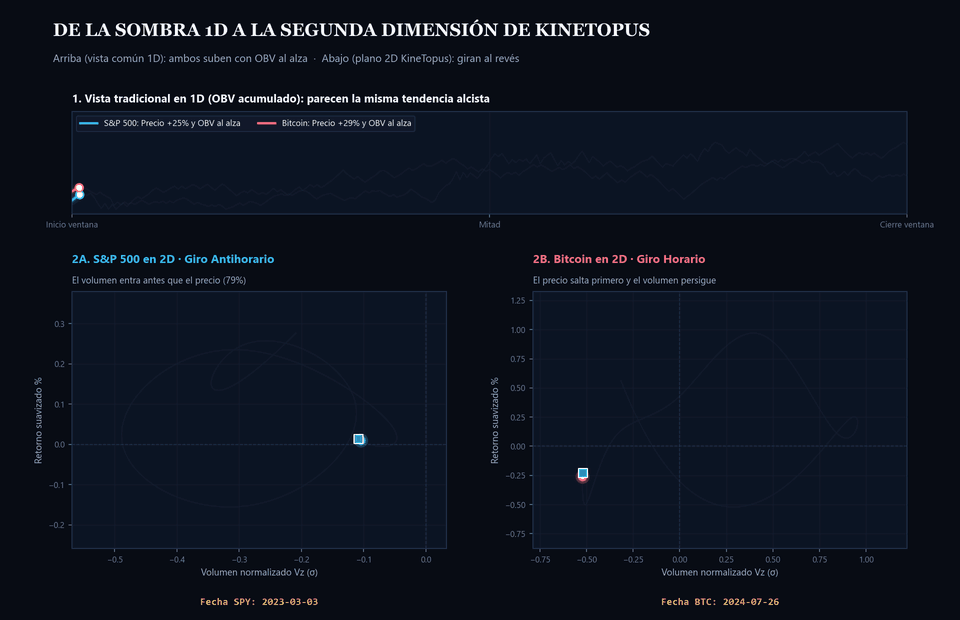
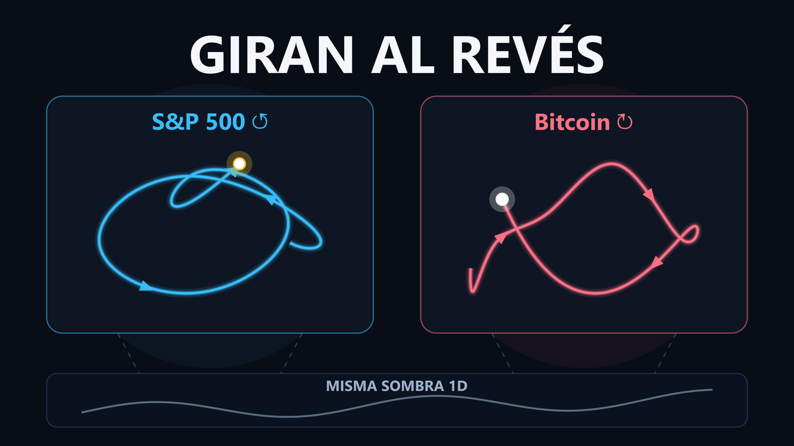
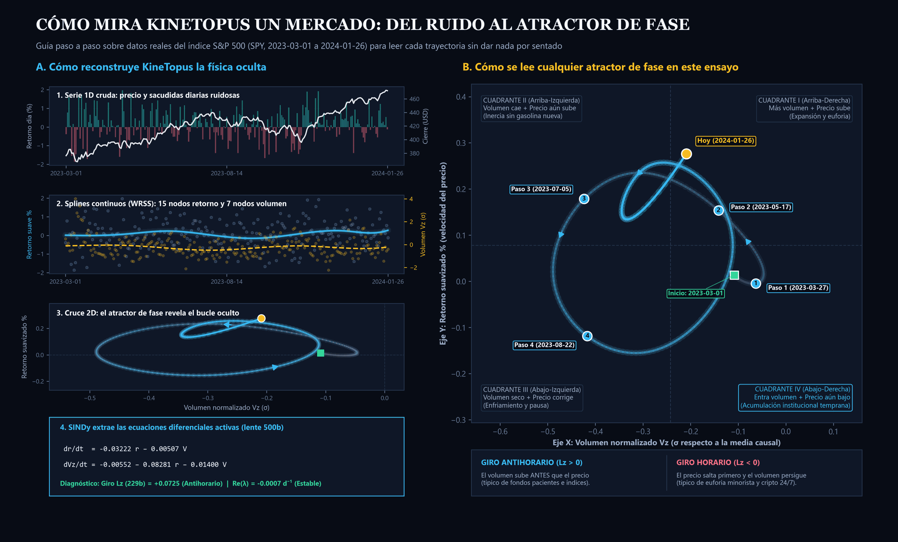
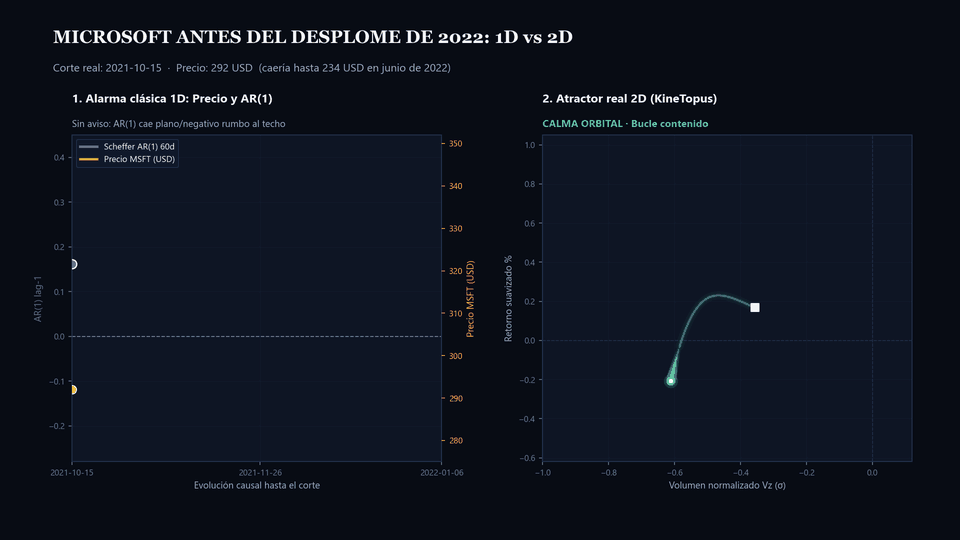
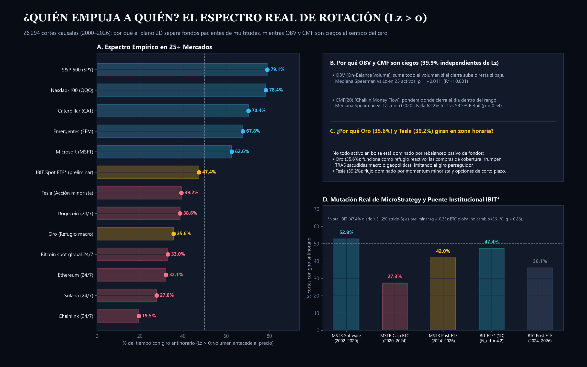
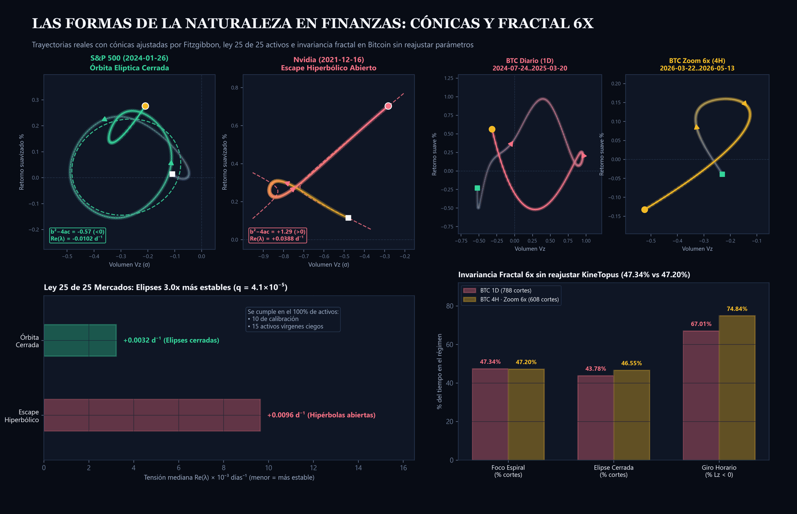
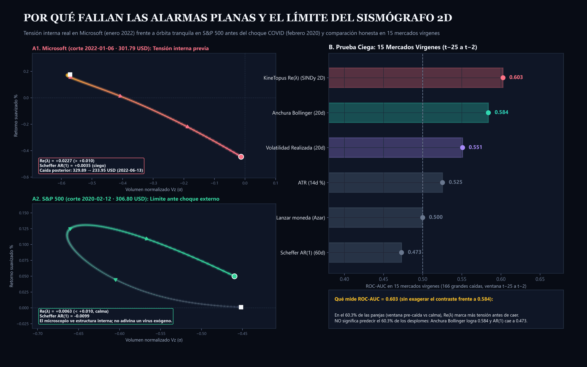
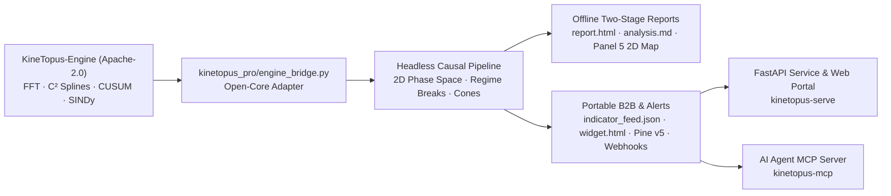
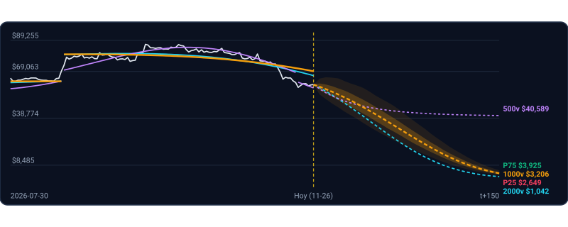

🌐 **English** | [Español](README.es.md)

<div align="center">

# 🔭 KineTopus-Analyst

**The Second Dimension of Money: A White-Box 2D Phase-Space Attractor Microscope for Real Markets**

*Built on top of [`KineTopus-Engine`](https://github.com/JuanDie778/KineTopus-Engine) (`Apache-2.0`) · Validated across `26,294` causal market snapshots (`2000–2026`)*

[](https://github.com/JuanDie778/KineTopus-Analyst/actions/workflows/ci.yml)
[](https://github.com/JuanDie778/KineTopus-Analyst/releases/tag/v0.4.0)
[](https://www.python.org/)
[](LICENSE)
[-22d3ee.svg)](https://github.com/JuanDie778/KineTopus-Engine)
<br>
[](https://papers.ssrn.com/sol3/papers.cfm?abstract_id=7431018)
[](https://doi.org/10.5281/zenodo.24166175)
[](https://orcid.org/0009-0008-9155-4653)
[](https://huggingface.co/spaces/Juan778/KineTopus_Engine)

🎬 **[Watch the 5-Minute YouTube Breakdown](https://youtu.be/2g9QCzV2B4E)** &nbsp;·&nbsp; 📝 **[Read the Full Substack Essay](https://substack.com/@juandiegoua778/note/p-225414681)** &nbsp;·&nbsp; 📄 **[Read the SSRN Paper](https://papers.ssrn.com/sol3/papers.cfm?abstract_id=7431018)**

</div>

---

## 🌀 The Illusion of the 1D Shadow

Look at two real market rallies side by side: the **S&P 500** climbs `+25%`, **Bitcoin** climbs `+29%`, and underneath both sits an almost identical cumulative volume line (`OBV`). On any trading screen built over the last sixty years, they appear to tell the exact same story.

**Turn the camera into the second dimension, and this emerges:**



**They are spinning in opposite directions.** Classic 1D indicators flatten two dynamic forces onto a single line — like two spinning tops rotating in opposite directions whose shadows on the wall look identical.

<div align="center">

[](https://youtu.be/2g9QCzV2B4E)

*👆 Click the thumbnail to watch the full visual walkthrough on [YouTube](https://youtu.be/2g9QCzV2B4E), or dive into the methodology & empirical tables in the [Substack Essay](https://substack.com/@juandiegoua778/note/p-225414681).*

</div>

---

## 🔬 From Galileo to the 2D Phase-Space Microscope

Imagine filming a stone falling from a balcony with an old shaky phone. If you subtract one frame from the next to measure velocity, hand tremor turns clean physics into jagged sawtooth noise. Fit a **causal continuous curve** first — smoothing tremor without ever looking at future frames — and `9.8 m/s²` reappears intact.

That is how [**KineTopus-Engine**](https://github.com/JuanDie778/KineTopus-Engine) works under the hood (`FFT` → causal `C² Splines` → `CUSUM` regime breaks → sparse `SINDy` ODEs). And in **Gran Estudio v3 (`26,294` causal walk-forward snapshots from `2000–2026`, frozen prior parameters, zero future leakage)**, we discovered its sharpest practical application: **turning flat price-vs-clock screens into a 2D Phase-Space Attractor Microscope** (`X = Normalized Volume Vz`, `Y = Smoothed Return %`).

Every market loop travels through **four clear seasons**:
1. **Quadrant IV (Bottom-Right):** Silent volume enters while price is still cold.
2. **Quadrant I (Top-Right):** Return accelerates as buying reaches consensus.
3. **Quadrant II (Top-Left):** Volume fades out while price coasts on inertia.
4. **Quadrant III (Bottom-Left):** Both price and volume cool down.

- **Counterclockwise (`Lz > 0`, `IV → I → II → III`):** Patient capital accumulates *before* the headline breaks.
- **Clockwise (`Lz < 0`):** Price jumps first, and the crowd chases afterward.

<details>
<summary>🗺️ <strong>Visual Guide: How to Read a Live 2D Phase-Space Attractor (Real S&P 500 Case)</strong> — Click to expand</summary>



</details>

---

## 📊 What 26,294 Real Snapshots Revealed (`2000–2026`, `15` Blind Markets)

Instead of competing as a speculative crystal ball, the 2D microscope uncovered four reproducible physical signatures across **27 series** (including **15 untouched blind markets** evaluated strictly out-of-sample):

| Discovery | Empirical Evidence (`26,294` Causal Cuts) | Why It Matters in Practice |
| :--- | :--- | :--- |
| **1. Hidden Chirality (`Lz`)**<br>*99.9% independent of `OBV` & `CMF(20)`* | **Institutional (`>55%` CCW):** `S&P 500 (79%)`, `Nasdaq-100 (78%)`, `CAT (70%)`, `EEM (68%)`, `MSFT (63%)`<br>**Reactive / 24/7 (`<40%` CCW):** `BTC (33%)`, `ETH (32%)`, `SOL (28%)`, plus `Gold (36%)` & `Tesla (39%)` | Proves the loop captures **collective psychology, not market hours**: patient accumulation vs. headline-chasing — completely invisible to `OBV` (`ρ = +0.011`) and `CMF` (`ρ = +0.020`). |
| **2. Live Corporate Mutation**<br>*MicroStrategy (`2018–2026`)* | `53%` CCW (18-year enterprise software firm) → **`27%`** (after adopting a Bitcoin treasury in Aug 2020) → **`42%`** (after 2024 spot ETFs; `IBIT` reads `47%` daily / `51%` weekly) | Same stock ticker mutated species on-chain in phase space while classic `CMF` stayed blind around ~`50%`. |
| **3. Ellipses vs. Hyperbolas (`Fitzgibbon`) & `6x` Fractal** | Closed ellipses are **`3x` more stable** (`Re(λ)` median `+0.0032` vs `+0.0096 d⁻¹`) across **`100%` (`25/25`)** of daily markets. Zero-retuning zoom to **`BTC 4H`** (`3,543` bars) keeps spiral focus locked at **`47%` vs. `47%`**. | Separates equilibrium-restoring orbits (`S&P 500`) from open escape trajectories (`Nvidia` late 2021) — an intrinsic market geometry, not a daily-bar artifact. |
| **4. 2D Seismograph (`Re(λ)`) vs. `Scheffer AR(1)`** | Across **`166` severe sell-offs** in `15` blind markets: **`ROC-AUC = 0.603`** (`Re(λ)`) vs `0.584` (`Bollinger Width`) and **`0.473` (`Scheffer AR(1)`)** (worse than a coin flip). | Detects internal fragility before major drops — e.g., **Microsoft in Jan 2022 (`330 → 234 USD`)**, where 1D `AR(1)` slept while the 2D orbit opened in red. |

### The 2D Seismograph in Action (`Microsoft`, Oct 2021 – Jan 2022)



<details>
<summary>🖼️ <strong>Deep-Dive Charts: Chirality Map, Fitzgibbon 6x Fractal & Blind ROC-AUC Benchmark</strong> — Click to expand</summary>

1. **Who Leads Whom (`26,294` cuts + `OBV`/`CMF` blindness + `Gold`/`Tesla`):**
   
2. **Closed Ellipses vs. Hyperbolas & `6x` Fractal Invariance (`BTC 1D` vs `4H`):**
   
3. **Blind `ROC-AUC` Ranking + Honest Limit (`S&P 500` on Feb 12, 2020 Pre-COVID):**
   

</details>

### ⚖️ A Navigation Instrument — With Explicit Honest Limits
A serious scientific instrument earns trust by showing **what it cannot see**:
- **Exogenous shocks stay exogenous:** On `February 12, 2020`, days before the COVID crash, the `S&P 500` drew a calm green ellipse — because no internal order-book fracture existed yet. **A 2D microscope measures internal capital fragility; it never predicts a virus.**
- **Long multi-year crises (`2008`):** Classic slow filters (`SMA-200`, `VolTarget`) still protect better standalone in protracted macro recessions; 2D phase tension shines as a **local risk modulator**.
- **Short spline horizons:** `not-a-knot` cubic spline edges only hold reliable curvature for a few days ahead, never months out.
- **Real practical payoff:** Hold positions with conviction while an asset orbits counterclockwise inside a stable ellipse; **cut risk or leverage by 50%** when rotation flips clockwise and `Re(λ)` opens into red tension (reducing max drawdown across `8/8` crypto assets net of costs).

---

## 🛠️ From Discovery to Software: `v0.4.0` Today & `v0.5.0` Next

**KineTopus-Analyst (`kinetopus_pro`)** is the local-first Open-Core product layer built on [`KineTopus-Engine`](https://github.com/JuanDie778/KineTopus-Engine):

- **What runs today in [`v0.4.0`](https://github.com/JuanDie778/KineTopus-Analyst/releases/tag/v0.4.0):** Reproducible CLI (`kinetopus-analyze`), 2-stage offline interactive `report.html` (which includes the **2D Return-Volume Phase Space & orbital chirality in Panel 5** alongside multi-scale curves and CUSUM forensics), compact JSON feed (`indicator_feed.json`), `< 35 KB` embeddable SVG `widget.html`, TradingView Pine Script v5 (`indicator.pine`), 6 SHA-256 deduplicated alerts + webhook dispatch, FastAPI Web Portal (`kinetopus-serve`), and `stdio` MCP server (`kinetopus-mcp`) bounded for `≤ 16 GB` RAM (`np.float64` `C_CONTIGUOUS`).
- **What comes next in `v0.5.0` ([Roadmap](docs/en/ROADMAP.md)):** Promoting the **Gran Estudio v3 2D Phase-Space Microscope** (`Lz` % CCW, Fitzgibbon ellipse/hyperbola fit, Lyapunov `Re(λ)` seismograph & 50% risk modulator) + **Multi-Asset Batch Scanner** directly into the primary hero view, widget, and API.



<details>
<summary>⚙️ <strong>Technical Preview of Current `v0.4.0` Artifacts (6-Panel Lab & &lt; 35 KB SVG Widget)</strong> — Click to expand</summary>

Panel 5 (`Mapa Retorno-Volumen`) in the current 6-panel lab renders the live 2D phase-space attractor and orbital direction alongside CUSUM tension (`Panel 6`) and exportable `< 35 KB` SVG widget telemetry:




</details>

---

## ⚡ Quick Start (100% Reproducible, Local-First)

**Requirements:** Python `3.10+` and `≤ 16 GB` RAM.

```bash
# 1. Install the open-source scientific core from GitHub
pip install "git+https://github.com/JuanDie778/KineTopus-Engine.git"

# 2. Clone and install KineTopus-Analyst (CLI, FastAPI Portal, MCP Server & pytest)
git clone https://github.com/JuanDie778/KineTopus-Analyst.git
cd KineTopus-Analyst
pip install -e ".[service,dev]"
```

```bash
# Run an offline-ready asset analysis (generates report.html, 2D Phase Space Panel 5, widget.html, Pine v5 & alerts)
kinetopus-analyze --ticker "SPY" --interval 1d

# Optional: include causal Walk-Forward OOS auditing
kinetopus-analyze --ticker "BTC-USD" --interval 1d --audit-oos

# Launch the Web Portal & B2B REST API (http://127.0.0.1:8000) or stdio MCP server
kinetopus-serve --host 127.0.0.1 --port 8000
kinetopus-mcp

# Run all 22 automated audit tests
pytest tests/ -v -W ignore::UserWarning
```

---

## 📚 Bilingual Documentation

| Document | English | Español |
| :--- | :--- | :--- |
| **Product Manifesto (2D Attractor North Star)** | [docs/en/MANIFESTO.md](docs/en/MANIFESTO.md) | [docs/MANIFIESTO.md](docs/MANIFIESTO.md) |
| **Open-Core Architecture (`v0.4.0`)** | [docs/en/ARCHITECTURE.md](docs/en/ARCHITECTURE.md) | [docs/ARCHITECTURE_PRO.md](docs/ARCHITECTURE_PRO.md) |
| **Roadmap (`v0.5.0` 2D Microscope & Scanner Next)** | [docs/en/ROADMAP.md](docs/en/ROADMAP.md) | [docs/ROADMAP_PRO.md](docs/ROADMAP_PRO.md) |
| **Changelog & Security Policy** | [CHANGELOG.md](CHANGELOG.md) | [SECURITY.md](SECURITY.md) |

---

## ⚖️ License, Commercial Use & Citation

**KineTopus-Analyst** is released under the [**KineTopus-Analyst Source-Available Non-Commercial Evaluation License**](LICENSE):
- ✅ **Permitted:** View, clone, study, and execute locally for **personal, educational, technical evaluation, or non-commercial academic research**.
- ❌ **Restricted without Commercial License:** Commercial trading/advisory products, SaaS/API hosting for third parties, paid signal feeds, or commercial redistribution.
- 🔓 **Upstream Open-Core:** Powered by [`KineTopus-Engine`](https://github.com/JuanDie778/KineTopus-Engine), which remains **100% Apache-2.0** (see [NOTICE](NOTICE)).

**Commercial / B2B Licensing & Inquiries:** Contact **Juan Diego Ussa Aponte** at [ussaapontejuandiego@gmail.com](mailto:ussaapontejuandiego@gmail.com) or [@JuanDie778](https://github.com/JuanDie778).

<details>
<summary>🎓 <strong>Cite the Underlying Scientific Research (BibTeX)</strong></summary>

```bibtex
@misc{ussa2026kinetopus,
  author       = {Ussa Aponte, Juan Diego},
  title        = {Kinetopus Engine: A Parsimonious Physical-Mathematical Pipeline for Local-First Financial Time Series Forecasting using Sparse Identification of Dynamical Systems (SINDy)},
  year         = {2026},
  doi          = {10.5281/zenodo.24166175},
  url          = {https://papers.ssrn.com/sol3/papers.cfm?abstract_id=7431018}
}
```

</details>

> ⚠️ **Disclaimer:** *Quantitative research and computational physics software based on historical market data (`2000–2026`). Nothing in this repository constitutes financial, investment, or trading advice.*
